

<!-- ==================================================================== -->
<!-- SECTION A: GITHUB CONTRIBUTION HEATMAP (TOP OF PROFILE)               -->
<!-- ==================================================================== -->

<!-- Animated 53-week contribution graph from authentic public GitHub data
  Auto-refreshed daily via .github/workflows/update-profile-art.yml -->

<h3><code>ritik@github ~ $ ./contributions.sh</code></h3>


 
 

<!-- ==================================================================== -->
<!-- SECTION B: TERMINAL WHOAMI — ASCII PORTRAIT + STATS DASHBOARD         -->
<!-- ==================================================================== -->

<!-- Left: Animated monochrome ASCII portrait generated from Ritik Raj's photograph
  Right: Authentic streak and contribution stats card with monthly bar chart
  Both SVGs are 840x880 so equal widths produce equal heights and seamless alignment. -->

<h3><code>ritik@github ~ $ whoami</code></h3>

<table>
<tr>
<td valign="top" width="420">
  
</td>
<td valign="top" width="420">
  
</td>
</tr>
</table>

 
 

<!-- ==================================================================== -->
<!-- SECTION C: NEOFETCH SYSTEM DASHBOARD                                  -->
<!-- ==================================================================== -->

<h3><code>ritik@github ~ $ neofetch</code></h3>

 
 

<!-- ==================================================================== -->
<!-- SECTION D: AI & DATA SCIENCE RESEARCH LAB WORKFLOW PIPELINE          -->
<!-- ==================================================================== -->

<h3><code>ritik@github ~ $ ./ai_research_lab.sh --workflow=overview</code></h3>

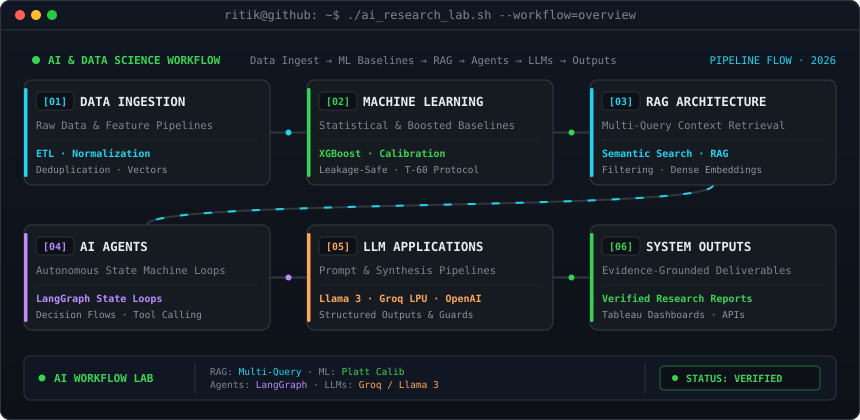

 
 

<!-- ==================================================================== -->
<!-- SECTION E: FEATURED PROJECTS — TWO FLAGSHIP SHOWCASES                 -->
<!-- ==================================================================== -->

<h3><code>ritik@github ~ $ ./featured_projects.sh --spotlight=flagship</code></h3>

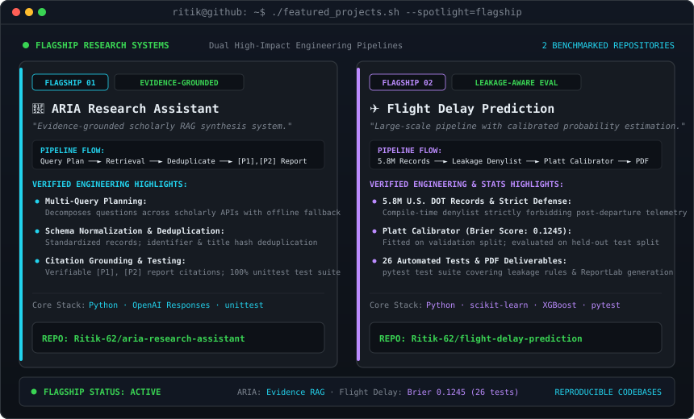

  <a href="https://github.com/Ritik-62/aria-research-assistant"><b>[ Explore ARIA Repository ──► ]</b></a>
  &nbsp;&nbsp;&nbsp;&nbsp;&nbsp;&nbsp;&nbsp;&nbsp;&nbsp;&nbsp;&nbsp;&nbsp;&nbsp;&nbsp;&nbsp;&nbsp;&nbsp;&nbsp;&nbsp;&nbsp;&nbsp;&nbsp;&nbsp;&nbsp;
  <a href="https://github.com/Ritik-62/flight-delay-prediction"><b>[ Explore Flight Delay Repository ──► ]</b></a>

 
 

<!-- ==================================================================== -->
<!-- SECTION F: ENGINEERING PROJECT SHOWCASE — 6 NODES                    -->
<!-- ==================================================================== -->

<h3><code>ritik@github ~ $ ./projects.sh --engineering-showcase</code></h3>

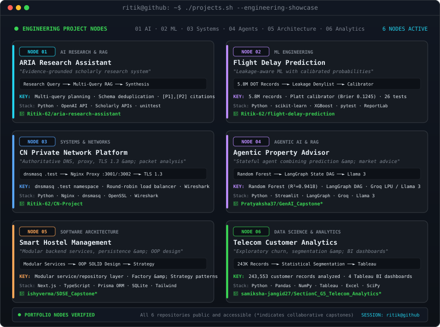

  <a href="https://github.com/Ritik-62/aria-research-assistant"><code>01. ARIA</code></a> ·
  <a href="https://github.com/Ritik-62/flight-delay-prediction"><code>02. Flight Delay</code></a> ·
  <a href="https://github.com/Ritik-62/CN-Project"><code>03. CN Project</code></a> ·
  <a href="https://github.com/Pratyaksha37/GenAI_Capstone"><code>04. Property Advisor*</code></a> ·
  <a href="https://github.com/ishyverma/SDSE_Capstone"><code>05. Smart Hostel*</code></a> ·
  <a href="https://github.com/samiksha-jangid27/SectionC_G5_Telecom_Analytics"><code>06. Telecom Analytics*</code></a>
   
  <i>*Collaborative capstone repositories hosted under collaborator GitHub accounts (<a href="https://github.com/Pratyaksha37">@Pratyaksha37</a>, <a href="https://github.com/ishyverma">@ishyverma</a>, <a href="https://github.com/samiksha-jangid27">@samiksha-jangid27</a>).</i>

 
 

<!-- ==================================================================== -->
<!-- SECTION G: DEVELOPER & RESEARCH LEARNING JOURNEY                     -->
<!-- ==================================================================== -->

<h3><code>ritik@github ~ $ ./my_journey.sh --timeline</code></h3>

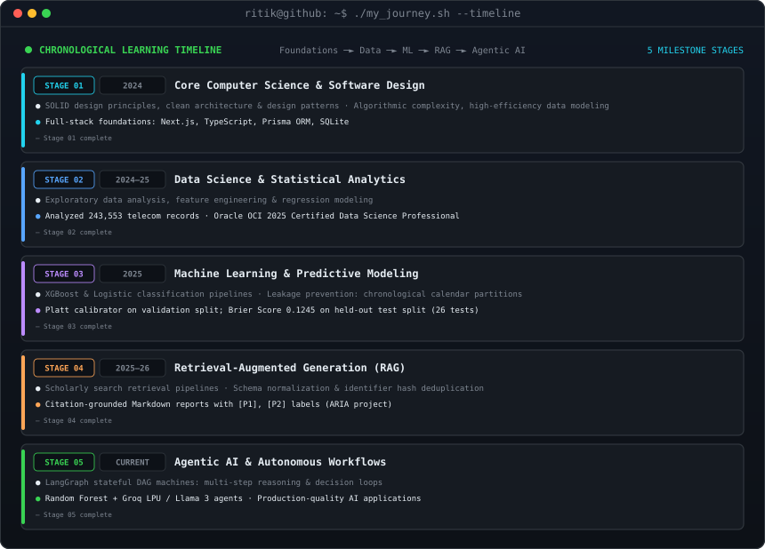

 
 

<!-- ==================================================================== -->
<!-- SECTION H: TECHNICAL INTERESTS & LEARNING FOCUS                      -->
<!-- ==================================================================== -->

<h3><code>ritik@github ~ $ ./technical_interests.sh</code></h3>

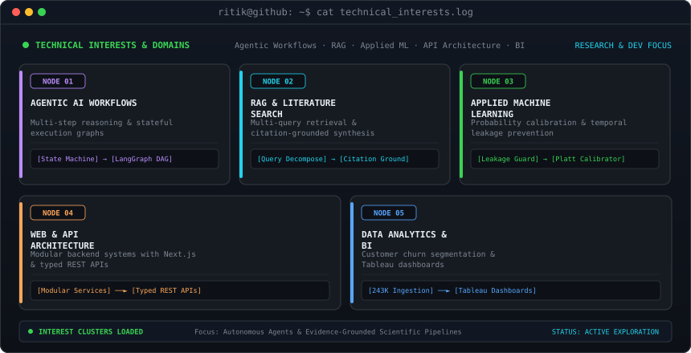

 
 

<!-- ==================================================================== -->
<!-- SECTION I: ABOUT ME & TERMINAL PROFILE                               -->
<!-- ==================================================================== -->

<h3><code>ritik@github ~ $ cat about_me.txt</code></h3>

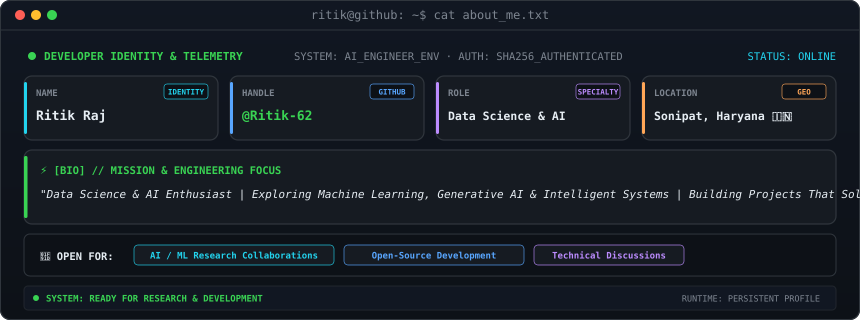

 
 

<!-- ==================================================================== -->
<!-- SECTION J: SKILLS & TECHNOLOGIES TREE                                -->
<!-- ==================================================================== -->

<h3><code>ritik@github ~ $ ./skills.sh</code></h3>

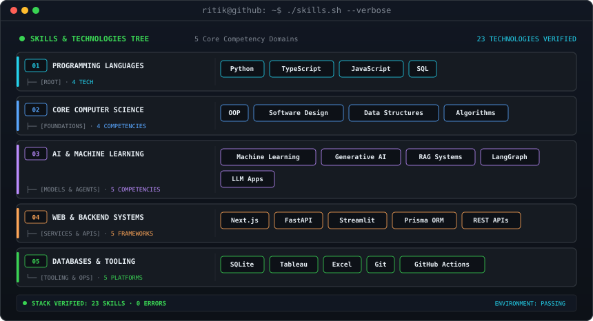

 
 

<!-- ==================================================================== -->
<!-- SECTION K: CERTIFICATIONS & CREDENTIALS                              -->
<!-- ==================================================================== -->

<h3><code>ritik@github ~ $ ./certs.sh</code></h3>

<a href="https://catalog-education.oracle.com/ords/certview/sharebadge?id=F3CFF318C714A647E2AE19A689763C16BC8005F4FB53D3DC6775A1216B7F2B59">
  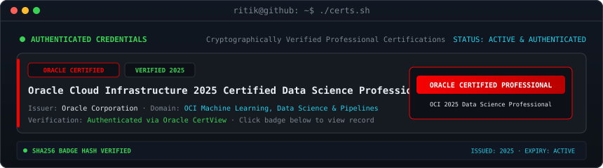
</a>

 
 

<!-- ==================================================================== -->
<!-- SECTION L: CONNECT & SOCIAL CHANNELS                                 -->
<!-- ==================================================================== -->

<h3><code>ritik@github ~ $ ./connect.sh</code></h3>

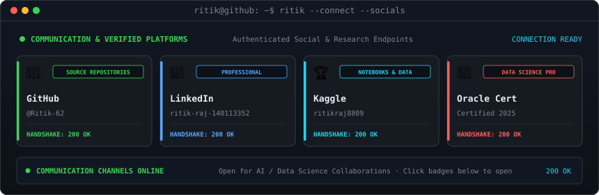

  
  &nbsp;&nbsp;
  
  &nbsp;&nbsp;
  
  &nbsp;&nbsp;
  

 

<h3><code>ritik@github ~ $ ./kaggle_status.sh</code></h3>

  
  &nbsp;
  
  &nbsp;
  
  &nbsp;
  

 
 

<!-- ==================================================================== -->
<!-- SECTION M: MINIMAL TERMINAL FOOTER                                   -->
<!-- ==================================================================== -->

<h3><code>ritik@github ~ $ exit</code></h3>

  <code>[Process completed — Session: ritik@github — AI &amp; Data Science Research Lab Portfolio · 2026]</code>
   
  Designed with unified dark monochrome terminal aesthetic · Ritik Raj Portfolio

